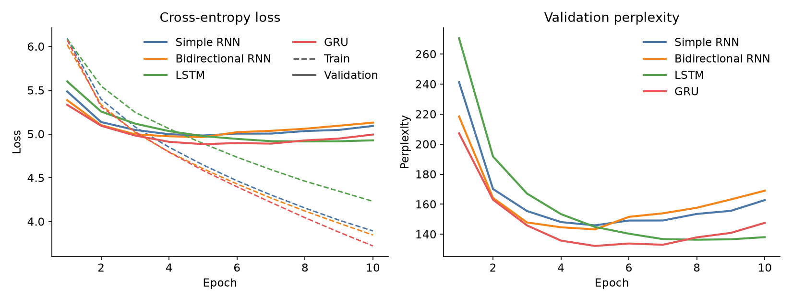
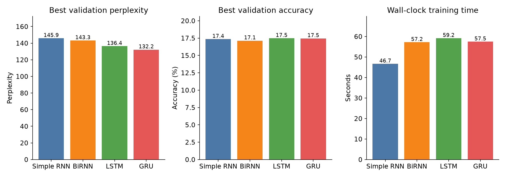
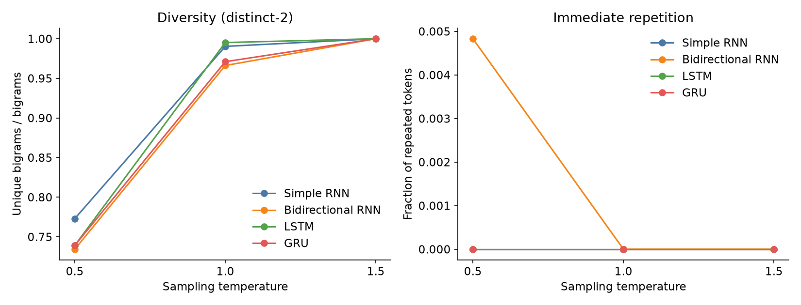

# Best Beloved: Autoregressive Text Generation on Kipling's Animal Tales

**Student:** Aditya Bhansali  
**Registration number:** 230953272  
**Course:** Foundations of Generative AI (ICT4403), Assignment 2

## Problem statement and objective

The task is to build a word-level autoregressive text generator: given a fixed window of preceding tokens, predict the next token, then append the sampled token and repeat. Four recurrent architectures are trained under the same data, objective, and optimiser so that differences in loss, perplexity, accuracy, training time, and the resulting prose can be attributed to the recurrent cell.

The system is called **Best Beloved**, after the narrator's address in *Just So Stories*.

## Dataset

The corpus is a single-author collection of late-Victorian animal fiction. The books share dialogue-heavy narration, repeated formulas, and a small cast of named animals, which gives a word-level model a realistic chance to learn local style.

| Book | Year | Tokens | Source |
| --- | ---: | ---: | --- |
| The Jungle Book | 1894 | 58,341 | https://www.gutenberg.org/ebooks/236 |
| The Second Jungle Book | 1895 | 73,647 | https://www.gutenberg.org/ebooks/1937 |
| Just So Stories | 1902 | 33,240 | https://www.gutenberg.org/ebooks/2781 |

Plain text used for training:

- https://www.gutenberg.org/cache/epub/236/pg236.txt
- https://www.gutenberg.org/cache/epub/1937/pg1937.txt
- https://www.gutenberg.org/cache/epub/2781/pg2781.txt

The Project Gutenberg files, including their license text, are stored in `data/raw/`. Preprocessing keeps only the body between the Gutenberg start and end markers.

### Characteristics

| Quantity | Value |
| --- | ---: |
| Tokens after tokenisation | 165,228 |
| Training tokens | 140,442 |
| Validation tokens | 24,786 |
| Unique training tokens | 8,601 |
| Vocabulary size (minimum frequency 2, plus `<unk>`) | 4,551 |
| Training type-token ratio | 0.061 |
| Sentences | 8,683 |
| Mean sentence length | 19.03 tokens |
| Training windows | 70,211 |
| Validation windows | 12,383 |
| Validation targets that are `<unk>` | 6.47% |

The type-token ratio is low because function words and stock phrases (`the`, `and`, `said`, `of the jungle`) dominate. The most frequent training tokens are `,`, `the`, `and`, `.`, `of`, `to`, `a`, and `he`. Commas and sentence boundaries are kept as tokens so the model can learn where a clause ends.

### Preprocessing and sequences

1. Strip the Project Gutenberg header and license footer.
2. Lowercase the text and map curly quotes and dashes to ASCII.
3. Tokenise with the pattern `[a-z0-9]+(?:['-][a-z0-9]+)*|[.,!?;:]`, so `stickly-prickly` stays one token and `. , ! ? ; :` become their own tokens.
4. Split each book chronologically, 85% train and 15% validation, then pool the splits. Overlapping windows from the same passage therefore cannot sit in both sets. The held-out text is the ending of each book.
5. Build the vocabulary on the training tokens only. A word that appears once becomes `<unk>`.
6. Build input-target pairs with context length 20 and stride 2. Each target is the single token that follows the window.

## Models

All four models use the same embedding size (128), dropout (0.2 on the embedding and on the summary vector), and a linear layer from a 256-dimensional state to the vocabulary. Weights are Xavier-initialised. The objective for every model is cross-entropy on the next token.

| Key | Architecture | Recurrent state |
| --- | --- | --- |
| `rnn` | Simple RNN | 256 hidden units, left to right |
| `birnn` | Bidirectional RNN | 128 units in each direction, concatenated to 256 |
| `lstm` | LSTM | 256 hidden units |
| `gru` | GRU | 256 hidden units |

The bidirectional model reads the context window in both directions and concatenates the two final states. The target token is outside that window, so the label is not visible during training. At generation time the same window is encoded, a token is sampled, and the window slides forward by one. This is what makes a bidirectional encoder comparable with the three causal models: every model conditions only on the same 20 tokens.

Parameter counts are close because the embedding and the output layer dominate. The LSTM is the largest because of its four gates.

| Model | Parameters |
| --- | ---: |
| Simple RNN | 1,850,951 |
| Bidirectional RNN | 1,818,183 |
| GRU | 2,048,583 |
| LSTM | 2,147,399 |

### Shared training setup

| Setting | Value |
| --- | --- |
| Optimiser | Adam, learning rate 0.001 |
| Epochs | 10 for every model |
| Batch size | 256 |
| Gradient clip | 1.0 |
| Seed | 42 |
| Device | Apple M2, PyTorch MPS (`torch` 2.14.1) |
| Checkpoint | Lowest validation loss, used for all samples |

Each model sees the same shuffled batches because the data loader is reseeded before every run. Reported training time is the full 10 epochs, including validation.

## Execution

```bash
python -m venv .venv
source .venv/bin/activate
pip install -r requirements.txt
python run_experiment.py
```

Dependencies are listed in `requirements.txt` (`torch`, `numpy`, `matplotlib`, `python-docx`). The script writes:

- `results/metrics.json` — hyperparameters, dataset statistics, per-epoch history, samples
- `results/dataset_stats.json`
- `results/generated_samples.md` — 70-word continuations
- `results/plots/training_curves.png`
- `results/plots/model_comparison.png`
- `results/plots/temperature_effects.png`
- `checkpoints/{rnn,birnn,lstm,gru}.pt`

`FGAI_Assignment2.ipynb` loads those artefacts and reprints the comparison. It does not retrain the models. A fresh run of `run_experiment.py` takes about four minutes on an M2. MPS kernels are not bitwise deterministic, so a second run can move the last reported digit slightly.

## Results

Figures below use the best validation epoch of each model.





| Model | Best epoch | Train loss | Val loss | Train perplexity | Val perplexity | Train accuracy | Val accuracy | Time (s) |
| --- | ---: | ---: | ---: | ---: | ---: | ---: | ---: | ---: |
| Simple RNN | 5 | 4.647 | 4.983 | 104.3 | 145.9 | 18.1% | 17.4% | 46.7 |
| Bidirectional RNN | 5 | 4.604 | 4.965 | 99.9 | 143.3 | 18.3% | 17.1% | 57.2 |
| LSTM | 8 | 4.461 | 4.916 | 86.6 | 136.4 | 19.8% | 17.5% | 59.2 |
| GRU | 5 | 4.584 | 4.885 | 97.9 | **132.2** | 19.3% | 17.5% | 57.5 |

A uniform distribution over 4,551 tokens has perplexity 4,551. Every model is far below that by epoch 2, so all four learn the corpus. They also all overfit. Training loss is still falling at epoch 10, while validation loss turns upward after epoch 5 (epoch 8 for the LSTM). Generation therefore uses the best validation checkpoint rather than the final epoch.

Validation accuracy sits in a narrow band, 17.1% to 17.5%. Next-word accuracy is a blunt score here: many continuations are acceptable, and the metric ignores how confident the model was. Perplexity, which uses the full distribution, separates the models. The LSTM's accuracy at its best epoch is 17.48% and the GRU's is 17.46%.

## Model comparison

**GRU** reaches the lowest validation loss (4.885) and the lowest validation perplexity (132.2). It does so at epoch 5, in 57.5 seconds.

**LSTM** is second, at perplexity 136.4. It needs three more epochs to get there and is the slowest run (59.2 seconds) and the largest network. Its training perplexity at the chosen checkpoint (86.6) is the lowest of the four, which is the overfitting gap: it fits the training endings more tightly without becoming the best model of the held-out endings.

**Bidirectional RNN** improves on the simple RNN by 2.7 perplexity points (143.3 against 145.9) and is slightly less accurate (17.1%). Reading the 20-token window backwards helps a little. It does not replace a gate. The extra backward pass also costs about 10 seconds relative to the simple RNN.

**Simple RNN** is the fastest model (46.7 seconds) and the weakest language model (perplexity 145.9). Its training curve has the same shape as the others, so the gap is capacity on this sequence length, not a failure to optimise.

## Sampling-temperature analysis

The same three seeds were continued for 70 tokens at temperatures 0.5, 1.0, and 1.5:

- `in the sea once upon a time`
- `now chil the kite brings home the night`
- `this is the hour of pride and power`

Sampling is `softmax(logits / temperature)`. The `<unk>` logit is masked for every model at decoding time, because that class is a bucket for rare words rather than a word that should be printed. Training and validation metrics still include it. Full continuations are in `results/generated_samples.md`.



Mean distinct-2 (unique bigrams divided by bigrams), averaged over the three seeds:

| Model | 0.5 | 1.0 | 1.5 |
| --- | ---: | ---: | ---: |
| Simple RNN | 0.773 | 0.990 | 1.000 |
| Bidirectional RNN | 0.734 | 0.966 | 1.000 |
| LSTM | 0.739 | 0.995 | 1.000 |
| GRU | 0.739 | 0.971 | 1.000 |

Immediate token repetition is essentially zero at every temperature. The only visible blip is the bidirectional RNN at 0.5 (rate 0.005), which includes a doubled `and and`. Repetition in these samples is phrasal, and distinct-2 plus reading the text is the measure that shows it.

**Temperature 0.5** is the most grammatical and the most repetitive. Clauses are short and often well formed, and the scene stays inside the animal books. The same frames recur: `of the jungle`, `and the little`, `he was a man`, `said the jackal`. The bidirectional model loops hardest (`the little time, and the little time`, and `the young wolves of the jungle` twice). The simple RNN keeps grammar and then mixes casts in one breath: the eldest magician, a red man, council rocks, and "the sun is the zebra". The GRU stays in the Kipling inventory with fewer doubled phrases:

> for the sake of the jungle was a new two, and the mugger of the tigers, and the jungle was the old people, and the bhagat of the jungle was a man. i have not much from the jungle people, and i have not come to the council

The LSTM at 0.5 has the cleanest local syntax of the set, with shaky agreement still present:

> and he was hungry, as he was a man, and he could not help him. he is a friend of the big boy, who were very good. it is a man, said the jackal.

**Temperature 1.0** is the useful operating point. Distinct-2 jumps to about 0.97–1.00, phrase loops recede, and dialogue tags from the books appear (`said bagheera`, `said kaa`, `said stickly-prickly`). The GRU's distribution is sharper, so at the same temperature it is slightly less diverse (distinct-2 0.971) than the LSTM (0.995). Lines still fail to build a plot. A representative LSTM continuation:

> ? said bagheera. i am tall husband! catching he is hold. if we shall trail. which is like the hunters yellow brother? i hate to trail! ... yes, said kaa. true!

**Temperature 1.5** drives distinct-2 to 1.0 for every model. The outputs become a shuffle of in-vocabulary names and objects (Mowgli, Bagheera, Tegumai, Nagaina, Kotick) with little syntactic role. Coherence collapses together with repetition. This temperature is a diagnostic, not a setting to publish text from.

Contextual consistency has a limit that temperature does not fix. The sea seed is abandoned within a sentence by every model; the dominant jungle prior takes over. The verse seed from the Law of the Jungle is continued as prose. Named entities are usually real names from the three books, which is lexical consistency, and they are often placed in the wrong story, which is a failure of longer context. A 20-token window and 140,000 training tokens are enough to learn the sound of the books and not enough to keep a scene.

## Conclusion

The **GRU** is the most effective autoregressive model for this dataset. Under a matched experiment it has the lowest validation perplexity (132.2), matches the LSTM on next-word accuracy (17.5%), and finishes in 57.5 seconds, level with the bidirectional RNN and faster than the LSTM. Its samples at temperature 1.0 stay inside Kipling's vocabulary without the low-temperature phrase loops of the bidirectional RNN.

The LSTM is the runner-up. It sometimes produces the most speech-like lines, and it is only 4 perplexity points behind, at a higher parameter count and a longer training time. The bidirectional RNN shows that a second direction over a short window is a small gain. The simple RNN is the cheapest model and the weakest language model.

For generation, temperature **1.0** is the setting that balances coherence and diversity. Temperature 0.5 is more grammatical and more repetitive. Temperature 1.5 is diverse and no longer readable as prose.

